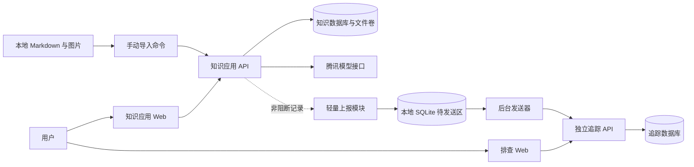

# Manifold 技术方案：先让知识问答可用、可信、可排查

- 日期：2026-11-26
- 状态：技术设计；尚未实现，不代表云资源或模型调用已验证。
- 需求来源：[需求文档](../../requirements/%20v1.md)及需求澄清。
- 本期目标：个人知识问答闭环、独立追踪服务、手写 RAG 与最小只读 Agent。

## 1. 先看结论

Manifold 是一个以 Markdown 为原始知识资产的个人知识应用。用户在外部工具中整理知识、生成概念关系图，通过网页浏览和提问，将实践结果写回笔记，形成「记录—提问—实践—反馈」的回路。

本期不建设在线编辑器和自动研究平台。最重要的交付物有两个：

1. **可研读的知识应用**：直接实现 RAG 和 Agent 的核心流程，不依赖封装这些流程的框架。
2. **独立的追踪与质量排查服务**：以一个 `trace_id` 还原一次回答的执行过程，帮助判断错误发生在哪一步。

追踪服务不是知识应用的内部管理模块。两者通过版本化 HTTP 接口协作，独立存储、运行和发布。追踪上报失败不得导致业务失败，已持久化的记录需要自动补报。

### 1.1 已确定的决策

| 主题 | 本期决定 |
| --- | --- |
| 使用形态 | 个人单用户 Web 应用，本地开发，优先部署腾讯云 |
| 编辑来源 | 本地 Markdown 和图片是唯一编辑源；网页只读笔记 |
| 关系图 | 前期由外部工具中的 skill 生成，应用只展示；应用内生成留到后续 |
| 外部资料 | 人工整理入库；不做联网搜索、网页抓取和自动文献核验 |
| 回答模型 | 腾讯 Hy；模型接入层可配置具体服务 ID |
| RAG / Agent | 核心手写，直接使用普通函数、数据结构和有限循环 |
| 排查系统 | 自建独立服务，不接入外部可观测性平台 |
| 接入规模 | 协议支持多个服务，本期只接入知识应用一个服务 |
| 上报故障 | 非阻断、后台补报；无法缓存时业务仍继续，显式暴露记录缺失 |
| 权限 | 本期单管理员、服务凭证；预留认证、操作权限与资源范围检查 |
| 交付顺序 | 先完成问答与全链路排查，再建设知识库更新维护能力 |

### 1.2 本期完整与暂不建设的边界

「最小完整」指使用链路可运行，而不是所有环节自动化。

本期包含：管理员登录、受保护的笔记与图片浏览、初始化入库及手动全量重建、带引用的 RAG 问答、最小只读 Agent、独立追踪服务及排查页面、人工准确性反馈。

本期不包含：多人协作、在线编辑、双向同步、增量维护平台、自动修复知识库、联网研究、多 Agent 协作、写入型工具、权限配置后台、SSO、多租户、通用运维大屏。

初始化入库和手动全量重建是问答可用的必要条件，不等同于第二阶段的知识库维护系统。

## 2. 用一次真实使用过程理解系统

用户在本地编辑一篇笔记，包含个人理解、外文资料原文、来源信息，以及外部 skill 生成的概念图。用户手动导入这组文件，服务建立一个可用知识版本。

随后，用户在网页提问。系统先检索笔记，把相关片段交给 Hy，返回带引用的解答，并标出哪些属于模型补充。回答旁提供 `trace_id` 和排查入口。

如果回答不准确，用户进入独立排查系统，依次查看：原问题、检索条件、候选片段、实际上下文、实际模型请求、模型返回和最终展示内容。用户标记问题并填写备注。

用户在现实中实践，在外部工具中修正笔记，再手动重建知识版本。本期先允许这个人工回路成立；后续再把反馈、更新和回归评估组织成维护流程。

## 3. 概念与实现边界

### 3.1 不混淆 RAG、Agent 和追踪

| 概念 | 定义 | 本期边界 |
| --- | --- | --- |
| RAG | 先检索资料，再将检索结果作为上下文生成回答 | 固定、透明的执行链路 |
| Agent | 模型根据任务和工具结果选择下一步行动 | 仅检索与读取知识，不写入、不联网 |
| Trace | 一次任务的跨步骤、跨服务执行记录 | 不负责执行任务，不是工作流引擎 |
| 准确性反馈 | 用户对回答是否正确、是否有依据的判断 | 人工标注；执行成功不等于回答正确 |
| 回放 | 查看当时的输入、输出与事件快照 | 本期支持；不代表重新执行 |
| 重跑 | 使用相同输入重新调用工具或模型 | 后续评估能力；不保证输出逐字一致 |

### 3.2 核心必须手写，但不重复实现基础设施

**必须直接实现：**

- 切分策略、检索编排、上下文选择与截断、提示词组装、引用校验。
- 工具定义与分发、参数校验、消息历史组织、Agent 执行循环、预算和停止条件。
- 关键中间结果的数据结构及对应追踪点。

**允许使用：**

- FastAPI、React、Ant Design、数据库驱动、迁移工具、Markdown 解析库。
- HTTP 客户端、模型官方 SDK、JSON Schema 校验库、密码散列与会话组件。
- PostgreSQL、pgvector、SQLite，以及 HTTP 追踪上下文标准。

**不使用：** LangChain、LlamaIndex、LangGraph、托管知识库编排或其他代替核心 RAG / Agent 流程的框架。也不自行发明通用节点引擎、插件注册框架或多层抽象工厂。

代码阅读路线应当直观：请求入口 → 检索 → 上下文 → 模型 → 引用 → 回答；Agent 则在这个基础上增加一个有明确上限的工具循环。

## 4. 架构：两个系统，一份稳定协议

### 4.1 部署关系

上报模块属于生产事件的一方，不是一个额外远端服务。每个接入服务都拥有自己的待发送存储与发送器。将来接入第二个服务，只需接入协议并传播追踪上下文。

| 系统 | 负责 | 不负责 |
| --- | --- | --- |
| 知识应用 | 入库、检索、回答、Agent、产生追踪事件 | 追踪历史查询、反馈管理、排查界面 |
| 追踪服务 | 接收事件、幂等存储、组织执行视图、排查与反馈 | 访问知识库表、执行模型请求、控制 Agent、修改笔记 |
| 上报模块 | 有界排队、本地持久化、批量发送、重试、健康计数 | 检索策略、模型决策、业务事务 |

### 4.2 技术选型

| 层次 | 建议 | 理由 |
| --- | --- | --- |
| 两套 Web | React + TypeScript + Vite；排查界面使用 Ant Design | 非核心能力复用成熟框架 |
| 两套 API | Python + FastAPI，独立入口、依赖清单和镜像 | 便于阅读 AI 流程，也便于隔离发布 |
| 知识存储 | PostgreSQL + pgvector；图片置于持久化文件卷 | 小规模无需独立向量数据库 |
| 追踪存储 | PostgreSQL，结构化字段 + JSONB | 支持筛选、步骤关系、输入输出快照 |
| 本地补报 | SQLite，单实例独占其文件卷 | 不增加消息队列服务 |
| 模型传输 | 优先 HTTP 客户端直接调用腾讯 TokenHub | 核心可读，不依赖 Agent SDK |
| 部署 | Docker Compose，本地与腾讯云 CVM 使用相同服务边界 | 降低初期运维成本 |

可以共用一个 PostgreSQL 实例，但知识应用和追踪服务必须使用不同数据库、账号和迁移目录；服务账号不能跨库访问。生产环境每套服务独立发布，不因另一套业务代码变化而被迫重建。

初期两个前端各自构建，静态资源可由反向代理提供，不为静态页面增加应用后端。建议使用两个同源站点，各自代理本系统 API，减少 CORS 和会话配置复杂度。

### 4.3 选择理由与没有选择的路线

- 不选核心编排框架：本项目的学习价值来自理解核心流程，而不是先学习框架。
- 不选外部追踪平台：追踪与质量排查是本项目的核心产品能力，需要自行维护协议、数据和界面。
- 不选独立向量数据库和消息队列：本期规模不足以证明这些组件的收益。
- 不把追踪服务合入知识应用：修改频率、发布节奏和数据生命周期不同。

## 5. 知识如何进入 RAG

### 5.1 原始资产与证据边界

本地 Markdown 和引用的图片是唯一编辑源。云端保存用于浏览、检索的副本与衍生索引。

| 对象 | 含义 |
| --- | --- |
| 笔记 | 一份 Markdown，可能同时包含个人理解、经验和外部摘录 |
| 来源 | 论文、书籍、文章等出处；记录标题、链接或书目信息，能提供时记录作者和日期 |
| 片段 | 带标题上下文、原文位置的可检索文本 |
| 知识版本 | 一次成功发布的文件清单、片段与向量集合 |
| 索引 | 可从原始资产重建的查询数据，不是原件 |

建议将原文、译文、个人理解分开书写。外文资料优先收集，但不将外文自动判定为更可靠的证据。答案优先引用实际相关、来源可辨认的材料；首版不自动声称某篇资料具有更高科学证据等级。

外文原文从实际入库内容中展示，不能让模型凭记忆生成一段文字再称为原文。个人笔记被引用，也不等于其观点已经得到科学验证。

图片只保存和展示，不做 OCR、图像向量化或图理解。概念图中的关键关系需有配套文字，否则不会参与首版检索。首版接收 PNG/JPEG/WebP 等受控图片格式，不直接内联执行不可信 SVG 或 HTML。

### 5.2 最小导入流程

1. 命令行工具读取指定目录的文件清单、Markdown 和被引用图片，通过认证接口提交。读取前必须确认真实路径位于选定根目录内；首版拒绝文件及路径组成部分中的符号链接，图片引用也适用，不能先读取目录外文件再指望服务端拦截。
2. 服务端另行校验文件类型、大小、上传相对路径、落盘路径和引用关系，拒绝越界及未授权文件访问。客户端读取安全与服务端存储安全互不替代；两端都不按笔记中的 URL 自动抓取远程资源。
3. 在未激活的知识版本中保存内容、切分并向量化。
4. 全部必要内容处理成功后，事务性切换当前版本指针。
5. 失败版本不参与检索；旧版本继续可用，导入错误可通过自己的 `trace_id` 排查。

本期采用一个管理员、一次一个导入任务。可用持久化任务记录与单工作线程，不引入通用任务队列；进程重启后将未完成任务标为中断，允许人工重跑。

全量重建以明确提交的文件清单为完整快照：不在新清单中的文件不进入新版本，发布前显示新增、替换和移除数量并由用户显式确认。首次导入无旧版本。重命名按旧文件移除、新文件加入处理。

本期不要求自动监视目录、按文件增量重建、断点续传或逐项编辑。内容摘要用于完整性校验与版本定位，向量缓存复用留待后续。

### 5.3 切分、向量与检索

- 先按标题层级识别结构，再按段落组合；短引用、代码块尽量保持完整，超长块允许继续切分并保留位置。
- 默认片段正文先以约 600–1000 字符试验，最终以评估及向量接口限制调整；字符不是 Token。
- 标题路径和必要上下文计入实际向量输入长度；发送前检查模型限制，不依赖供应商静默截断。
- 保存笔记相对路径、内容摘要、标题路径、原文范围、片段序号与切分策略版本。
- 每个知识版本绑定向量模型服务 ID、维度、预处理配置。问题和文档使用兼容的同一套模型配置；更换模型或维度必须重建知识版本。
- 首版在活动版本范围内做精确余弦距离排序，初始取前 6 个候选，去重后按上下文预算选择。小数据先不用 HNSW 等近似索引；需要时通过评估再增加。
- 所有模型与向量输入输出必须检查维度、有限数值、空返回等错误；零向量不能当成有效召回。

不预设一个跨模型通用的相关性阈值。先保留分数和人工评估数据，再决定阈值、混合检索、重排或问题改写是否必要。

每次问答开始时固定一个知识版本，Agent 后续补检索和读取也使用该版本，避免一次回答混用更新前后的资料。

## 6. 一次回答的核心流程

### 6.1 固定 RAG 是基线

1. 验证用户身份及 `question:ask` 权限，生成 `trace_id`。
2. 固定知识版本，对原问题生成查询向量并检索。
3. 选择候选片段，分配只在本次回答有效的引用编号。
4. 组装系统约束、用户问题、引用片段及上下文预算。
5. 调用 Hy，获得答案和引用标记。
6. 校验引用编号，组织最终展示结构，返回答案与 `trace_id`。

本期默认单次问答，不依赖多轮会话记忆；用户可连续提问，但每次以显式输入为准。将来加入历史时，必须记录实际带入模型的历史消息。

模型请求与返回先使用非流式方式，便于得到清楚的执行边界；追踪事件仍可异步产生。流式显示是后续体验优化，不改变追踪协议。

### 6.2 回答的证据契约

答案必须区分「知识库依据」「模型补充或推断」「依据不足」，不要求每次套长模板。

- 引用只能使用服务端提供的片段编号；链接由服务端生成，不直接信任模型输出的文件路径和 URL。
- 引用入口先展示本次实际使用的片段快照，再提供跳转对应笔记版本的能力；不能拿更新后的正文解释历史答案。
- 来源链接必须来自已入库材料，合法协议经过过滤；缺少来源信息时如实显示缺少来源。
- 无有效片段时明确说明知识库依据不足。仍可提供标注清楚的模型补充，但不能附上虚构文献或原文。
- 模型生成了未知引用编号时，将其标为无效、不生成来源链接，并在结果中提示引用校验未通过；本期不为此无限重试模型。
- 编号存在只证明链接有效，不证明该片段支持答案。语义支持度通过人工反馈与评估检查。

上下文选择需记录实际选择顺序、去重、截断与舍弃原因。笔记和工具结果是不可信资料，不能改变系统约束或授予工具权限。

### 6.3 错误处理

没有入库版本、模型认证失败、超时、限流、返回格式错误等都给出明确状态与可用的 `trace_id`，不能把异常包装成正常知识答案。模型请求采用有限重试和总超时，单次尝试分别记录；不得将供应商错误全文中的凭证透传给用户。

业务数据库或模型不可用可能导致业务失败；追踪服务、上报线程或本地待发送区不可用则不得导致业务失败。这两类故障不能混为一谈。

## 7. 第一个 Agent：只解决补充查找

目标不是自动完成复杂研究，而是：一次检索依据不足时，能否改换关键词或阅读上下文后再回答。

### 7.1 工具与循环

仅开放两个工具：

| 工具 | 输入与输出 | 约束 |
| --- | --- | --- |
| `search_notes` | 查询文本，返回带出处的片段 | 固定知识版本、召回数量与输出预算 |
| `read_note` | 笔记 ID、章节或范围，返回原文 | 固定知识版本，只读有权访问的笔记 |

每次先做一次知识库检索，再让模型基于工具结果决定是否补充检索、读取或结束。保留固定 RAG 模式用于对照；Agent 模式不是替代基线的唯一入口。

手写流程包括：声明工具 → 调用模型 → 校验工具名和参数 → 依次执行工具 → 按工具调用 ID 回传结果 → 继续或结束。

初始预算建议为最多 4 次工具执行（含首次检索）、最多 6 次模型调用和可配置总时限；具体值通过体验调整。预算在每次执行前检查，并为最终总结预留一次调用。达到预算时只允许基于已有材料结束，不再执行工具。

模型同轮提出多个工具时按顺序执行，每个调用独立校验和记录；超过预算的调用返回对应错误结果，不能遗留未配对的工具消息。未知工具、非法参数和重复调用也必须有明确结果，不直接执行模型生成的任意代码。

### 7.2 可观察而不是暴露内部思考

记录模型提出了什么工具请求、应用实际执行了什么、工具返回了什么，以及停止原因。页面不把模型内部思考文本当成执行事实，也不要求展示内部推理过程。

如选定模型协议要求保留某些消息状态，由模型接入层按官方协议处理；其支持情况需接入实测，不在核心循环中凭猜测删改协议字段。

本期不做进程崩溃后的 Agent 自动续跑。中断会留下不完整追踪，用户可重新发起一个新任务。

## 8. 独立追踪服务：把一次回答变成可检查的事实

### 8.1 Trace、Span、Event 的职责

| 对象 | 含义 | 主要信息 |
| --- | --- | --- |
| Trace | 一次完整任务 | `trace_id`、任务类型、来源、请求概要 |
| Span | 一个执行步骤 | `span_id`、`parent_span_id`、步骤类型、输入输出、状态 |
| Event | 执行期间的一条不可变事实 | `event_id`、事件类型、序号、发生时间和负载 |

建议最小事件种类为 `trace.started`、`span.started`、`span.event`、`span.finished`、`trace.finished`。异常是明确事件或结束状态，不通过异常字符串猜测状态。

统一事件信封包含：

| 字段组 | 字段 |
| --- | --- |
| 协议与幂等 | `schema_version`、`event_id` |
| 调用关系 | `trace_id`、`span_id`、`parent_span_id` |
| 来源 | `service_name`、`service_instance_id`、`environment`、`service_version` |
| 事件 | `event_type`、`sequence`、`occurred_at`、`payload` |
| 扩展元数据 | 操作者标识、模型服务 ID、索引版本、提示词摘要等非凭证信息 |

`sequence` 在同一个 Span 内单调递增，不设计跨服务全局计数器。Trace 生命周期事件归属根 Span。服务端补充可信的接收时间和资源范围，不信任客户端声明的权限或工作空间。

模型、检索、入库、HTTP 调用只是 Span 类型。追踪服务可以提供这些类型的友好渲染，也必须能够显示未知类型的通用结构化内容。

### 8.2 跨服务传播

采用 W3C Trace Context 的 `traceparent` 格式，内部调用继承同一 `trace_id`，被调用方创建子 Span。HTTP、后台任务和线程切换都需显式保留上下文；不能假设线程局部变量会自动跨进程传播。

公共入口默认生成新的可信根 Trace，不让用户任意指定内部追踪关系。内部请求仅在完成调用方认证后继承合法上下文。`trace_id` 是关联标识，不是访问凭证。

同一 Trace 可以出现多个服务，页面以父子关系为主要依据。各主机的墙钟可能有偏差；单步耗时由本进程单调时钟测量，不能仅用跨机时间戳计算精确调用耗时。

每个服务只能写自己产生的 Span。追踪服务从凭证获得来源服务与资源范围，拒绝伪造另一服务的 Span 归属；子 Span 可以引用授权范围内另一服务的父 Span。

Trace 根声明绑定不可变的 `root_service` 和 `root_span_id`；只有配置中获准创建该任务类型根 Trace 的服务，才能提交根生命周期事件并改变整体业务状态。本期只有知识应用有此权限。子事件可以先到，但不能据此认领根，未经核实的根关系保持待关联。其他服务不能提交已属于知识应用的 Trace 结束事件。未来允许多个根创建方时，冲突根声明标为协议冲突、保留异常证据，不以先到或后到覆盖已有归属。

入库拥有独立 Trace，问答通过 `knowledge_version` 和 `import_trace_id` 关联它，不把知识库整个生命周期强行塞进同一个 Trace。

### 8.3 每个关键步骤记录什么

| 环节 | 需要记录的事实 |
| --- | --- |
| 请求入口 | 原问题、运行模式、实际使用的历史上下文、操作者、知识版本 |
| 查询向量化 | 实际输入、模型 ID、预处理配置、维度、耗时与错误；不保存大段原始向量 |
| 检索 | 查询条件、候选片段快照、距离或分数、排序、选中情况 |
| 上下文组装 | 实际片段、顺序、去重及舍弃原因、预算和估算方式 |
| 模型调用 | 应用实际提交的消息、工具定义、模型参数、供应商请求 ID、返回内容、可获得的用量 |
| 工具执行 | 模型请求的名称与参数、校验结果、实际执行结果、重试与预算消耗 |
| 回答处理 | 引用校验、模型原始答案、最终展示答案、降级或失败原因 |
| 结束 | 业务结果、总耗时、停止原因 |

保存当时实际使用的文本快照，而不仅是笔记 ID、摘要或外部 URL。提示词摘要只能定位版本，不能替代提示词正文。供应商未返回 Token 用量时记为未知，不伪造数值。

严格过滤 Authorization、Cookie、API Key、密码等凭证。业务正文与提示词按敏感数据保护；如果配置了内容脱敏，需明确标记脱敏字段，不能宣称可还原脱敏前的完整输入。内部推理内容不作为默认展示或检索内容。

### 8.4 独立存储与接收语义

追踪库建议保留四类数据：Trace 摘要、Span 视图、不可变事件、人工反馈。事件是执行事实的依据，摘要和步骤视图由接收时更新，用于快速查询。

批量接收时，服务端按事件校验，在本地数据库事务中写入事件并更新相应视图。只有提交成功后，才能返回该事件已接收。按可信资源范围与 `event_id` 建唯一约束。

相同 ID、相同事件的重复发送返回已接收；相同 ID、不同内容是冲突，不得覆盖原记录。接收乱序事件时，不让后到的开始事件覆盖已存在的结束状态；缺失父步骤可以暂存并等待补齐。

同一 Span 的来源、父关系和步骤类型固定；同一序号不能对应不同的语义事件。每个 Span 只有一个终态，重试用新的子 Span 表达，不能将已结束的步骤重新打开。不同事件 ID 却占用相同序号、多个互相矛盾的终态或关系变化，都保留冲突证据并将视图标为协议冲突、业务结果未知，不采用最后写入覆盖。冲突事件返回不可重试的逐项错误，客户端保留失败记录。

视图归并由事件语义、序号和冲突规则决定，不依赖到达顺序；同一事件集合以不同顺序接收后应得到相同视图。只承诺能够显示已接收事实与已知缺口，不承诺仅凭根结束事件推断所有子步骤已经到齐。

## 9. 非阻断补报：可靠性边界必须诚实

### 9.1 上报路径

业务仅将已选定、大小受控的数据快照交给有界内存队列，不等待远端上报。后台工作线程完成序列化、SQLite 持久化和发送。入队数据不能保留会被后续业务修改的可变引用；必要的快照复制有成本，需要在性能验收中测量。

上报 API 必须异常隔离、非阻塞入队。监控异常不得改变模型调用、业务事务或返回值，也不得关闭业务服务。非阻断表示不等待远端与不因监控失败而失败，不表示记录事件完全没有 CPU 或内存开销。

SQLite 使用持久化卷，每个生产实例独占自己的数据库文件；初期每实例使用一个业务工作进程，进程内一个后台发送器。不在多个容器间共享 SQLite 文件，也不以每次部署都丢失的临时目录作为待发送区。

### 9.2 待发送记录的生命周期

| 状态 | 行为 |
| --- | --- |
| 待发送 | 已持久化，等待后台批量发送 |
| 等待重试 | 网络失败、限流、临时服务端错误；指数退避加随机抖动，遵守有效的 `Retry-After` |
| 已确认 | 远端明确持久化或确认重复接收后，清理本地记录 |
| 待人工处理 | 协议错误、事件冲突等无法靠重试修复的问题；保留原事件及原因 |

认证失效先保留事件并低频重试、告警，凭证修正后恢复。收到 413 时可拆分批次；单事件仍超限时保留失败记录，不能悄悄截断提示词后假装记录完整。

批量接口返回逐项结果，客户端只清理明确成功的事件。服务端已落盘但响应丢失时重发，由接收幂等解决重复问题。应用重启后自动重新加载未确认事件。

本地存储设置容量上限。已持久化且未确认的事件不因重试次数达到上限就自动丢弃；满载时拒绝新事件的监控入队或落盘，业务继续，旧记录仍尝试补报。人工清理必须是显式操作。

### 9.3 不能同时保证的两件事

业务永不被监控阻断，与任何故障下事件绝不丢失，不能同时保证。

- 事件尚在内存、进程突然退出：可能丢失尚未落盘部分。
- 磁盘故障且内存队列已满：新事件可能无法保存。
- 业务步骤完成但结束事件未记录：只能知道步骤曾开始，不能推断其结果。
- 本机或持久化卷永久丢失：本地未送达事件无法凭空恢复。

本期明确采用 fail-open：上述情况业务仍继续。通过标准错误输出、非敏感健康计数和后续可发送的丢失摘要暴露异常；丢失计数自身在崩溃时也可能不完整，不把它当成精确审计账本。

记录当前待发送数量、最老待发送时间、失败记录数量、最近成功时间、落盘失败和丢弃计数。追踪服务失联时这些数据仍能在生产方本地查看。业务 readiness 不依赖追踪服务或上报器状态。

禁止追踪上报 HTTP 请求递归产生新的上报事件。待发送区、日志输出和重试线程均有资源限制，不能因监控积压耗尽业务资源。

共用 CVM 或 PostgreSQL 实例时，追踪接收端同样需要连接池、查询时限、请求速率、CPU 与内存限制，并为追踪数据、索引及 WAL 预留容量预算。设置磁盘安全水位，接近水位或历史清理失败时暂停接收、返回可重试错误，由有界待发送区承接，不能以 30 天保留期替代容量保护。条件允许时使用独立卷和存储配额；共享实例仍存在共同故障边界，不承诺物理隔离级别的零干扰。容量保护与补报降速需要一起验收，避免恢复时集中补报冲垮共享数据库。

### 9.4 保留与安全

追踪服务默认按 Trace 最近接收时间保留 30 天的快照、事件和反馈，可配置；清理时以任务为单位处理，并显示保留策略。需要长期保留的评估样本另行人工导出，不自动变成第二个知识库。

未确认的本地待发送事件不跟随远端历史保留策略自动删除，但受本地容量限制。迟到记录按实际接收时间获得保留窗口；界面同时显示原发生时间，避免误认为刚刚执行。

知识文件、追踪快照和本地 SQLite 都可能含私密笔记，卷和备份采用相应的访问限制及存储加密能力。追踪服务本期不保存密钥，也不提供未经鉴权的快照或文件地址。

## 10. 排查页面：围绕错误回答组织交互

### 10.1 三个主要视图

| 视图 | 重点能力 |
| --- | --- |
| 任务列表 | 精确查询 `trace_id`；按发生时间、服务、环境、业务状态、反馈筛选；分页 |
| 执行详情 | 问题与最终答案、步骤树、事件时间线、选中步骤的输入输出及错误 |
| 反馈 | 准确／不准确／无法判断，备注与问题归因，可关联整次任务或具体步骤 |

首版不做跨所有提示词的全文搜索。列表默认不返回完整敏感负载；详情按需加载，减少响应大小。

业务状态与记录状态分别展示：

- 业务状态：运行中、成功、失败、取消、未知。
- 记录状态：接收中、已接收结束记录、存在已知缺口、长期未结束。

收到结束记录不显示为「已证明完整」。已知序号缺口、缺失父步骤、只有开始无结束等都应可见；没有发现缺口也不等于没有任何事件丢失。

打开尚未收到事件的 `trace_id` 时，显示「记录尚未到达或不存在，可稍后重试」，不能直接断言业务任务不存在。用短间隔轮询刷新即可，不为首版增加 WebSocket 服务。

### 10.2 用户如何定位问题

建议沿以下顺序排查，而不是先改提示词：

1. 正确资料是否入库：知识覆盖问题。
2. 是否召回必要片段：切分、向量或检索问题。
3. 是否进入实际上下文：去重、筛选或预算问题。
4. 模型是否遵循材料：生成或提示词问题。
5. 引用是否支持结论：引用依据问题。
6. 用户实际看到的内容是否与模型返回一致：后处理或展示问题。

人工反馈不能自动修改原笔记，也不等于科学正确性的最终裁决；它用于积累可检查的问题样本。

### 10.3 UI 与权限接入

排查界面遵循统一运营 UI 的布局、筛选表格、详情抽屉、加载态、空状态、错误态规范。使用 `AuthAdapter`、`PermissionAdapter` 接入身份和权限，不将管理员数值等级散落在组件中。

输入输出是纯文本或受控结构化渲染，不能直接作为 HTML 执行。笔记、模型答案和排查内容统一关闭原始 HTML 或做严格净化；图片只能解析到本系统受鉴权且带版本的资产，禁止浏览器自动加载远程图片或其他嵌入资源，并用 CSP 限制图片及连接来源，避免通过图片 URL 携带正文外传。

来源外链来自已入库来源信息，只允许用户显式点击访问，不把笔记正文或提示词拼接为查询参数；设置 `Referrer-Policy: no-referrer`，新窗口链接使用 `noopener noreferrer`。模型生成的其他链接默认显示为文本，不作为经过核验的来源或自动访问入口。

## 11. 权限：现在做最小实现，边界现在就存在

### 11.1 本期不建设权限平台，但不能没有服务端权限

本期只有一个真人管理员。知识应用与追踪服务分别配置管理员登录、独立会话和签名或散列密钥；可由同一个人使用，不共享数据库会话，也不先建设 SSO。

建议使用成熟组件实现密码校验和会话：

- 管理员用户名和 Argon2id 密码散列由部署配置或 secret 文件提供，不内置默认密码，不把明文密码放进前端。
- 随机不透明会话 ID 使用服务端持久化会话记录，设置有效期；退出立即撤销。凭证与会话值不进入追踪。
- 两个站点各自使用 `HttpOnly`、生产环境 `Secure`、合适的 `SameSite` Cookie，不设置跨站点共享 Cookie。
- Cookie 认证的修改请求启用 CSRF 防护与 Origin 校验；登录限速，认证失败不暴露账号是否存在。
- 开发环境显式配置本地账号；生产配置缺少身份密钥时启动失败，不退化为匿名管理员。

本期无注册、找回密码、用户管理页面、角色编辑页面。管理员配置变更与凭证轮换由运维配置完成。

### 11.2 三类主体，互不混用凭证

| 主体 | 本期认证方式 | 允许行为 |
| --- | --- | --- |
| 真人管理员 | 登录会话 | 本系统已明确授予的查询和操作 |
| 导入工具 | 独立 Bearer 凭证 | 向知识应用提交、查询导入任务；不持有管理员会话 |
| 上报服务 | 每服务独立 Bearer 凭证 | 向追踪服务上报指定来源的事件；不能查询追踪正文 |

服务端仅保存或配置服务 Token 的散列及其服务归属，客户端从 secret 文件读取原值；不在仓库或日志中写明文。初期只有一个上报服务凭证，但配置按服务列表组织，不能设计成所有服务共用一个全能密钥。

本期无需建设服务凭证管理页面。轮换时可短期并存新旧凭证，再撤销旧凭证。

### 11.3 预留的是权限检查点，不是空白大平台

每个服务将认证结果归一为主体：`principal_id`、`principal_type`、`permissions`、`workspace_id`。本期工作空间固定为 `personal`，不是多租户产品；工作空间由服务端身份配置确定，不能相信请求正文传值。

后端在 API 和工具访问边界执行统一的 `authorize(principal, action, resource)` 检查，默认拒绝未明确授予的权限。初期管理员获得列举的权限，不通过「永远返回 true」模拟鉴权。

| 系统 | 权限动作示例 |
| --- | --- |
| 知识应用 | `note:read`、`question:ask`、`knowledge:import` |
| 追踪服务 | `trace:write`、`trace:read`、`trace:payload:read`、`feedback:write` |

资源具有所属工作空间；读笔记、图片、Trace、Span、快照、反馈均检查资源范围。敏感原问题和答案归入负载读取权限，普通列表摘要不泄露正文。服务凭证额外绑定允许的来源服务与环境，禁止通过伪造 `service_name` 冒充其他服务。

前端从 `/api/v1/me` 获取本系统授予的动作，通过适配器过滤导航、路由和按钮；真正的保护始终在后端，不能只隐藏页面。

未来可把配置式权限映射替换成数据库 RBAC 或外部身份认证，保留现有主体、动作和资源检查接口。是否增加组织、多租户和跨工作空间共享，需要另外设计，不能宣称预留一个字段就已经支持。

## 12. 最小接口与数据模型

### 12.1 接口边界

以下路径表达稳定职责，具体字段在实现前以 OpenAPI 固化；它们不是已经存在的接口。

| 所属服务 | 接口 | 职责 |
| --- | --- | --- |
| 各自独立 | `POST /api/v1/session`、`DELETE /api/v1/session`、`GET /api/v1/me` | 登录、退出、身份与权限 |
| 知识应用 | `POST /api/v1/imports`、`GET /api/v1/imports/{id}` | 提交及查看全量导入 |
| 知识应用 | `GET /api/v1/notes`、`GET /api/v1/notes/{id}` | 笔记与指定版本浏览 |
| 知识应用 | `GET /api/v1/assets/{id}` | 受保护的图片访问 |
| 知识应用 | `POST /api/v1/questions` | 指定 RAG / Agent 模式，返回答案、片段引用和 `trace_id` |
| 追踪服务 | `POST /api/v1/events:batch` | 幂等批量接收，返回逐项确认或错误 |
| 追踪服务 | `GET /api/v1/traces`、`GET /api/v1/traces/{id}` | 查询列表和执行结构，不默认内联敏感大负载 |
| 追踪服务 | `GET /api/v1/traces/{id}/spans/{span_id}/events` | 按需读取事件与输入输出，检查负载权限 |
| 追踪服务 | `POST /api/v1/traces/{id}/feedback` | 写入人工反馈及操作者 |

事件上报身份不允许调用查询、反馈接口。未认证返回 401，已认证但无权限返回 403；资源范围校验不得暴露其他范围的内容。

事件协议独立版本化。允许兼容新增可选字段，拒绝不支持的重大版本；未知 Span 类型可通用展示。协议定义可放在同一仓库的独立目录，但两套服务不能通过互相导入业务模块来共享运行逻辑。

上报批次和单事件设置明确大小上限，业务模型上下文与工具输出也有自己的预算。超限记录明确失败，不以静默截断冒充完整快照。初始上限需结合真实提示词样本配置，不在未测试时承诺任意大负载。

### 12.2 核心数据模型

| 所属 | 数据 | 关键关系 |
| --- | --- | --- |
| 知识应用 | 导入任务 | 状态、错误、`import_trace_id`、待发布版本 |
| 知识应用 | 知识版本 | 活动指针、文件清单摘要、向量与切分配置 |
| 知识应用 | 笔记、资源、片段 | 归属知识版本与工作空间，保留原文和位置 |
| 追踪服务 | Trace 摘要 | 工作空间、根服务、业务状态、接收状态、时间 |
| 追踪服务 | Span 视图 | Trace 内标识、父标识、来源、类型、状态 |
| 追踪服务 | 事件 | 幂等 ID、序号、发生与接收时间、负载快照 |
| 追踪服务 | 反馈 | Trace / Span、准确性标记、备注、操作者、时间 |
| 各服务独立 | 会话 | 主体、会话摘要、有效期及撤销状态 |
| 上报方本地 | 待发送事件 | 不可变事件、尝试次数、下次时间、错误、状态 |

跨服务只通过标识、快照和 API 关联，不建立跨数据库外键。知识应用不依赖追踪库保存当前可用的问答结果，用户拿到的引用片段必须随回答返回；排查入口故障不能使回答无法阅读。

本期不做无限问答历史。页面刷新后的历史查询以追踪保留期内的排查记录为准；知识库本身不会因为追踪记录过期而消失。

## 13. 模型接入：已核实事实与实施验证分开

2026-11-26 查阅腾讯官方文档得到以下信息；这不是实际账号的成功调用证明。

| 项目 | 建议与约束 |
| --- | --- |
| 接入入口 | TokenHub 广州站点，Base URL 为 `https://tokenhub.tencentmaas.com/v1` |
| 认证 | Bearer API Key；站点与 Key 需匹配 |
| 对话 | `POST /chat/completions`，相对上述 Base URL |
| Hy 候选 | `hy4-flash`，官方列出 Function Calling；质量不足时评估 `hy4` |
| 文本向量候选 | 腾讯 TokenHub `kinfra-text-embedding-0.6b`，1024 维，通过 `/embeddings` |
| 向量输入限制 | 官方当前明确单条不超过 2000 字符，批量建议不超过 128 条；不能拿 32k 模型上下文替代接口限制 |
| 检索距离 | 余弦距离；不能假定文本向量已经归一化 |

这里把「AI 使用腾讯 Hy」落实为回答和 Agent 决策使用 Hy；向量化推荐腾讯平台当前提供的文本向量服务，不把 `kinfra` 宣称为 Hy 命名的模型。若向量模型也必须限定为 Hy 品牌，需在接入前确认替代服务，不能静默换成其他供应商。

旧混元 `GetEmbedding` 官方页面已标注预下线，预计日期为 2026-12-21，因此不作为新项目默认入口。预览模型也不作为长期默认依赖。

接入层只负责模型协议差异与传输，不代替 RAG 或 Agent 决策。模型 ID、Base URL、超时、输出预算和密钥均从配置读取；记录实际服务 ID、参数和供应商返回的版本信息。供应商没有给出不可变模型版本时，需承认同名模型未来可能变化。

### 实施前的短验证

- 当前账号能否开通并调用候选 Hy 和文本向量服务，额度、价格与地域是否合适。
- 工具调用 ID、参数、工具结果回传和模型状态字段的真实协议行为。
- 实际向量维度、中文与外文输入、长输入校验和限流行为。
- 超时、错误响应、Token 用量与供应商请求 ID 的可获得性。
- 若向量候选无法满足约束，先确认替代选型，不把托管知识库当作绕过核心手写要求的方案。

## 14. 工程组织与发布原则

建议代码目录按可独立发布的系统组织，而非先拆大量 Python 包：

| 建议目录 | 职责 |
| --- | --- |
| `apps/knowledge-api/` | FastAPI 入口、手写 RAG / Agent、模型接入、知识存储 |
| `apps/knowledge-web/` | 笔记浏览、问答与追踪入口 |
| `apps/trace-api/` | 事件接收、查询、反馈、身份与权限 |
| `apps/trace-web/` | 排查运营界面 |
| `packages/trace-client/` | 小型上报模块，不依赖两套服务的业务代码 |
| `contracts/trace/` | 事件协议与兼容性样例，不是运行时编排框架 |
| `deploy/` | 本地与 CVM 部署配置、卷与反向代理配置 |
| `evals/` | 人工维护的问题、相关资料标注和期望依据 |

核心模块保持少量直观文件，例如检索、上下文、回答、工具和循环。不要为了扩展可能性创建层层继承或隐藏控制流的装饰器。追踪使用显式步骤边界或简单上下文管理，不改变核心业务返回值。

依赖精确版本在实施时验证兼容性后锁定，不在纯设计阶段凭空保证一组版本可以运行。

初期一台 CVM 可运行全部组件，但知识应用、追踪服务分别有健康检查与发布入口。数据库不对公网开放；外部访问使用 TLS，服务间上报优先私网并使用凭证。

备份包括知识原始文件、活动版本信息、追踪库和必要配置；本地待发送区使用可在进程重启后保留的卷。向量索引可重建，但追踪历史不是可从当前笔记还原的衍生数据。需要实际执行恢复演练，而不仅是配置备份任务。

## 15. 交付次序与验收

### 15.1 第一阶段：先让问答可排查

| 里程碑 | 交付 | 验收重点 |
| --- | --- | --- |
| 追踪骨架 | 独立服务、最小登录与权限、事件接收、列表和详情 | 模拟任务可按 ID 还原；无业务代码依赖 |
| 上报可靠性 | 本地持久化、批量上报、幂等、补报、健康计数 | 追踪服务断开不影响模拟业务，恢复后补报 |
| RAG 闭环 | 导入、笔记浏览、检索、回答、引用 | 用实际问题逐步看到输入输出，错误可以定位 |
| 最小 Agent | 两个只读工具、有限循环、统一追踪 | 能补充查询、有预算和明确停止原因 |
| 质量反馈 | 人工标注、小评估集、故障演练 | 区分答错、检索失败和执行异常 |

先贯通模拟事件，再接真实 RAG，最后接 Agent；不是等业务写完才补埋点。

### 15.2 第二阶段：知识库更新维护

在第一阶段问题样本基础上，再设计增量同步、删除与索引更新、失败重试界面、来源补全、实践反馈整理和回归评估。只有存在明确质量或性能问题，才加入混合检索、重排、自动研究和应用内绘图技能。

权限管理后台、多人使用与协作均是独立增量，不因本期预留权限接口就提前实现。

### 15.3 关键业务测试

测试围绕高风险逻辑，不机械要求每个文件都有一个测试文件。

**RAG 与 Agent：**

- 标题、引用和长块切分的原文位置可回溯，向量输入不会静默超限。
- 导入失败保留旧版本；一次问答始终使用同一知识版本。
- 空知识库、无相关依据、未知引用编号、外文原文与译文区分正确。
- 未授权工具、非法参数、重复调用、超预算和超时均可控。
- 模型补充不伪装成已核验的来源，工具结果中的指令不改变权限。

**追踪与补报：**

- 停止追踪服务，业务仍可回答；恢复后已落盘事件自动补报。
- 生产方重启后待发送事件仍在；响应丢失导致重发时不重复入库。
- 部分成功、事件冲突、乱序、缺失父步骤、迟到结束记录被正确处理；同一事件集合不同到达顺序得到相同视图。
- 两个模拟服务构成同一 Trace，真实部署仍只有一个上报服务；子服务不能冒充根服务改变整体状态。
- 队列满、磁盘故障、记录超限不导致业务失败，不掩盖记录缺失。
- 追踪库达到安全水位时暂停接收，恢复后限速补报，不耗尽共享存储与连接资源。
- 进程中断后，未结束步骤显示未知或中断线索，不伪造成功。
- 追踪正文与原笔记更新解耦，历史输入输出不随笔记改变。

**权限与安全：**

- 未登录不能查看笔记、图片、Trace 或快照；会话退出后失效。
- 上报凭证不能读追踪正文，导入凭证不能执行管理员操作。
- 不能伪造来源服务或跨资源范围读写；仅有 `trace:read` 不能读敏感负载。
- CSRF、Markdown 注入、越界文件路径和超限请求有防护；导入工具读取前拒绝符号链接逃逸。
- 笔记、回答和追踪视图不自动加载外链图片，不向外部站点泄漏正文或 Referrer。
- 事件、异常日志和排查界面不包含认证密钥或会话值。

### 15.4 质量评估与性能基线

先整理约 20 个真实问题，覆盖直接查找、术语查询、跨笔记综合、外文引用、知识库无答案。每条记录预期相关笔记或片段、关键事实和不应出现的结论，而不是只存一段固定标准答案。

分别检查检索是否命中必要资料、回答是否受资料支持、引用是否准确、无依据时是否诚实。按个案查看 Trace，避免用一个总分掩盖错误原因。本期不以模型自评分替代人工判断。

记录问答总耗时、各模型调用耗时、可获得的 Token 用量、上报本地开销、补报吞吐与磁盘占用，形成小规模基线。性能门槛在确定 CVM 规格、知识规模和账号配额后设定，不在没有测量时承诺固定延迟。

## 16. 风险、限制与后续决策

| 风险 | 本期应对 |
| --- | --- |
| 有引用但结论错误 | 区分结构校验与语义支持度，保存快照，人工评估 |
| 资料来源质量不足 | 保留原文与出处，不以外文或入库身份自动认证科学性 |
| 模型与接口变化 | 使用当前官方入口，配置化模型，保存实际调用信息，实测后锁定 |
| 非阻断上报丢失窗口 | 明确内存与存储故障边界，补报已落盘记录，暴露已知缺口 |
| 快照含私人知识 | 访问控制、受限文件卷、保留期限、凭证过滤 |
| 两套服务增加部署量 | 单机 Compose 起步，保持独立发布，不提前建设集群 |
| 预留权限变成过度设计 | 仅主体、动作、资源范围和检查点，不做权限平台 |
| Agent 看似灵活但质量下降 | 保留固定 RAG 基线，用同一评估集比较 |

尚需实施时确定的是账号实际可用模型、资源规格、预算、域名和保留容量。这些不改变已确定的架构；若腾讯向量候选不符合模型约束，则在接入前单独确认，不自行替换需求。

## 17. 官方参考

以下页面于 2026-11-26 查阅，仅证明文档中列明的接口能力，不证明当前账号已开通或已完成调用：

1. [TokenHub 语言模型调用概览](https://cloud.tencent.com/document/product/1823/130079)：接入地域、认证与 Chat Completions。
2. [TokenHub 模型列表](https://cloud.tencent.com/document/product/1823/130051)：Hy 候选及 Function Calling 能力。
3. [TokenHub 向量模型](https://cloud.tencent.com/document/product/1823/133515)：模型维度、输入限制与向量接口。
4. [旧混元向量化接口](https://cloud.tencent.com/document/product/1729/102832)：预下线状态，不作为新项目默认依赖。
5. [TokenHub Chat Completions 字段说明](https://cloud.tencent.com/document/product/1823/135872)：实施时核对完整消息协议；本次仅从调用概览取得链接，未逐字段验证。
6. [W3C Trace Context](https://www.w3.org/TR/trace-context/)：跨服务上下文传播的标准参考；实施时校验格式与边界行为。
